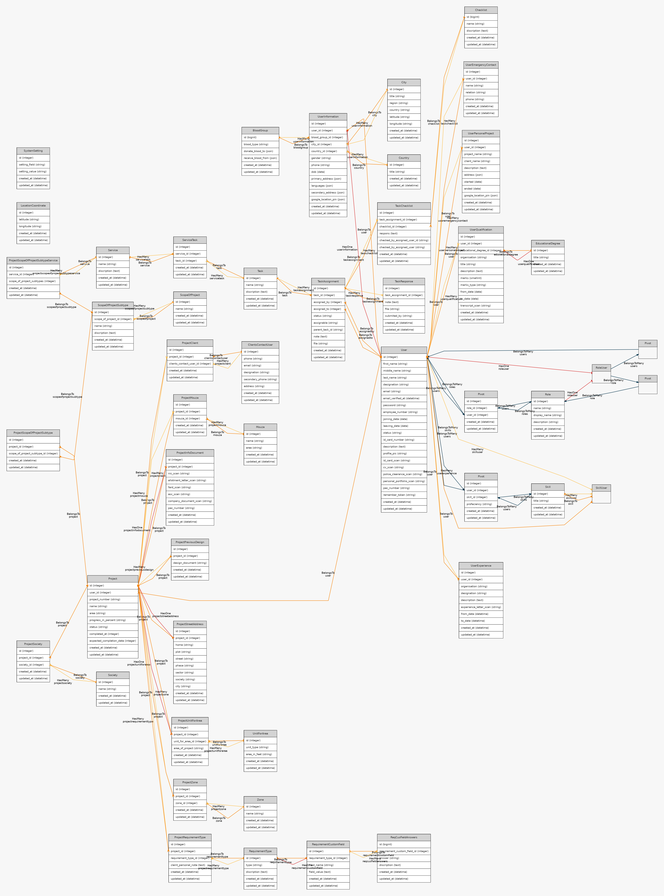

<p align="center"></p>

# Urban Solution — Project Management for an Architecture & Urban-Planning Firm

A role-based web application built (2020) for an architecture / urban-planning practice in Pakistan to run
its projects end to end: client intake, land and site records, project scoping, service-based task
assignment with checklists, and staff HR profiles.

**Stack:** Laravel 7 · PHP 7.2 · Vue 2 · MySQL · Laravel Mix

## What it does

| Area | Features |
|---|---|
| **Projects** | Project number, area, progress %, expected completion; street address, zones, housing societies, *mouzas* (revenue-estate land records) and area units per project |
| **Client intake** | Clients and contact persons, requirement types with admin-defined **custom fields** and per-project answers, uploaded documents (NIC, allotment letter, *fard*, previous designs) |
| **Scoping** | Scope of project → subtypes, mapped to firm services |
| **Work management** | Services → tasks → **task assignments** (assigned by / to, parent tasks), task responses with file uploads, and reusable **checklists** per assignment |
| **People / HR** | Staff profiles: qualifications, experience, skills with proficiency, emergency contacts, personal portfolio projects, document scans |
| **Access control** | Role-based access with separate **Admin**, **Principal** and **Assistant** areas (route groups + middleware) |
| **Settings** | System and project settings, master data (cities, countries, blood groups, degrees, units) |

## Data model

About 40 tables. Full entity-relationship diagram:



Key design choices:
- **Configurable requirements**: `RequirementType` → `RequirementCustomField` → `ReqCusFieldAnswers` lets admins
  add intake questions per project type without schema changes (an EAV-style extension point).
- **Work decomposition**: `Service` → `ServiceTask` → `Task` → `TaskAssignment` → `TaskResponse` / `TaskChecklist`
  separates *what the firm offers* from *who is doing what on which project*.
- **Land-record domain modelling**: projects link many-to-many to mouzas, societies, zones and area units,
  matching how plots are identified in local land administration.

## Code layout

```
app/
  Http/Controllers/{Admin,Principal,Assistant,Auth}/   role-scoped controllers
  *.php                                                Eloquent models (Laravel 7 default namespace)
database/migrations/                                   schema (~40 tables)
resources/                                             Blade + Vue 2 views
routes/web.php                                         role-grouped routes (auth + role middleware)
```

## Running locally

```bash
composer install
npm install && npm run dev
cp .env.example .env && php artisan key:generate   # set DB_* in .env
php artisan migrate
php artisan serve
```

Requires PHP 7.2–7.4 and MySQL 5.7+ (Laravel 7).

## Status

Delivered in 2020 and kept as a portfolio reference; not under active development.
